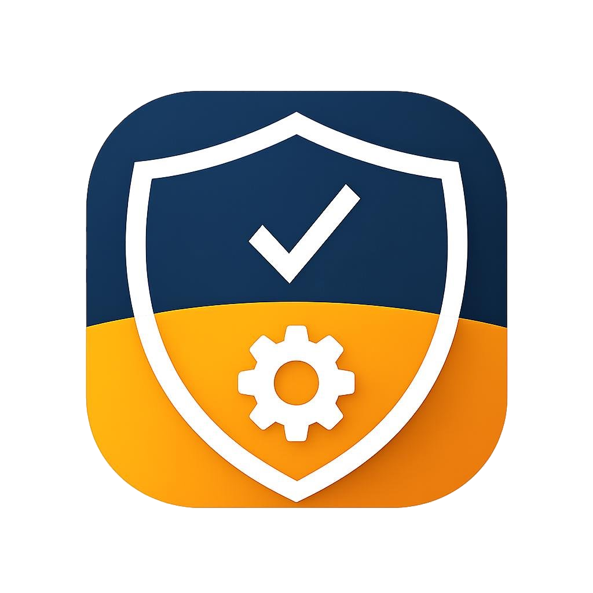
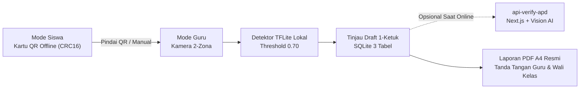

<p align="center">
  <a href="https://github.com/maulana-mash/SiK3">
    
  </a>
</p>

<h1 align="center">SiK3</h1>

<p align="center">
  <strong>Sistem Inspeksi K3 Bengkel Sekolah Berbasis Android (100% Offline-First)</strong><br />
  Aplikasi Flutter Android dual-peran (Mode Guru ber-PIN lokal &amp; Mode Siswa tanpa login) untuk memeriksa kelengkapan 6 Alat Pelindung Diri (APD) bengkel melalui QR identitas, kamera 2-zona TFLite, draft SQLite lokal, dan ekspor laporan PDF A4 bertanda tangan.
</p>

<p align="center">
  <a href="https://github.com/maulana-mash/SiK3/releases/latest">
    
  </a>
  
  
  
  
</p>

<p align="center">
  <a href="#fitur-utama">Fitur Utama</a> &bull;
  <a href="#alur-inspeksi--arsitektur">Alur &amp; Arsitektur</a> &bull;
  <a href="#struktur-proyek">Struktur</a> &bull;
  <a href="#pemasangan-apk--kompilasi">Kompilasi</a> &bull;
  <a href="#lisensi">Lisensi</a>
</p>

---

## Fitur Utama

1. **Single-APK Dual-Role Tanpa Server Akun:**
   - **Mode Guru (PIN Lokal 4–6 Digit):** Mengelola daftar kelas, mengatur preset APD wajib, memindai siswa, meninjau draft inspeksi, dan mencetak laporan PDF A4.
   - **Mode Siswa (Tanpa Login):** Menyimpan identitas praktik lokal (Nama, NISN, No. Presensi, Kelas, Jurusan) dan menampilkan Kartu QR Identitas kontras tinggi untuk antrean masuk bengkel.
2. **Kartu QR Offline + Cadangan Input Manual:**
   - Payload QR menggunakan format JSON `v=1` tervalidasi checksum CRC16-CCITT; tersedia form input manual saat siswa tidak membawa ponsel.
3. **6 Standar APD Bengkel Kustom Per Kelas:**
   - Mendukung pengaturan wajib/opsional untuk **Baju Praktik**, **Helm Safety**, **Kacamata Safety**, **Masker**, **Sarung Tangan**, dan **Sepatu Bengkel** lengkap dengan ikon vektor SVG murni.
4. **Kamera 2-Zona Terpandu & Human-in-the-Loop TFLite:**
   - Memindai **Zona Atas** dan **Zona Bawah** secara otomatis (zona tanpa APD wajib langsung dilewati) dengan ambang keyakinan transparan (`0.70`). Item berkeyakinan rendah atau non-publik ditandai `Perlu Cek` agar keputusan final tetap di tangan guru dengan koreksi satu ketuk.
5. **Draft SQLite Minimalis & Laporan PDF A4 Resmi:**
   - Menggunakan 3 tabel SQLite (`classes`, `inspection_sessions`, `scan_records`) dengan *upsert* siswa bebas duplikasi.
   - Menghasilkan PDF A4 berlogo SiK3, tabel siswa urut presensi, matriks ceklis dinamis, rekap kepatuhan, serta blok tanda tangan sejajar Guru Mata Pelajaran dan Wali Kelas.
6. **Verifikasi Vision AI Online Opsional (`api-verify-apd/`):**
   - Menyediakan subsistem opsional Next.js / Vercel AI SDK v6 (`POST /api/verify-apd`) sebagai opini kedua saat daring tanpa pernah menghambat alur utama offline.

---

## Alur Inspeksi & Arsitektur



| Lapisan | Teknologi | Detail |
|---|---|---|
| **Aplikasi Mobile** | Flutter (`sdk ^3.13.7`), Material 3 | Target Android `id.sch.sik3` (`minSdk 24`, `targetSdk 35`) |
| **Database & Prefs** | `sqflite`, `shared_preferences` | 3 tabel draft lokal + hash PIN lokal |
| **Kamera, QR & ML** | `camera`, `mobile_scanner`, `qr_flutter`, `tflite_flutter` | Pemindaian 2-zona, kompresi foto maks. 800px JPG |
| **Dokumen PDF** | `pdf`, `printing`, `flutter_svg` | Ekspor & pratinjau laporan A4 offline |
| **Opsional Cloud AI** | Next.js + Vercel AI SDK v6 (`api-verify-apd/`) | Endpoint verifikasi APD opsional saat tersedia internet |

---

## Struktur Proyek

```text
SiK3/
├── lib/                    # Kode utama Flutter (onboarding, student, teacher, ml, pdf, data)
├── assets/
│   ├── icons/              # Logo resmi SiK3
│   ├── svg/                # Ikon vektor 6 standar APD
│   └── models/             # Model PPE TFLite modular & konfigurasi label
├── test/                   # Unit & widget test (Flutter test + sqflite_common_ffi)
├── api-verify-apd/         # Subsistem opsional backend Next.js / Vercel Vision AI
├── PRODUCT.md              # Kontrak produk & batasan ruang lingkup
└── DESIGN.md               # Spesifikasi sistem desain & aksesibilitas
```

---

## Pemasangan APK & Kompilasi

### Pasang APK Rilis via ADB
```powershell
adb install -r build\app\outputs\flutter-apk\app-release.apk
```

### Kompilasi dari Kode Sumber (Flutter)
**Prasyarat:** Flutter SDK terbaru (Dart `^3.13.7`), Android SDK (API 35), dan JDK 17+.

```powershell
git clone https://github.com/maulana-mash/SiK3.git
cd SiK3
flutter pub get
flutter test
flutter run
flutter build apk --release
```

### Subsistem Vision AI Online (Opsional)
Panduan konfigurasi variabel lingkungan dan deployment tersedia pada [`api-verify-apd/README.md`](api-verify-apd/README.md).

---

## Lisensi

Proyek ini dirilis di bawah lisensi **MIT**.
